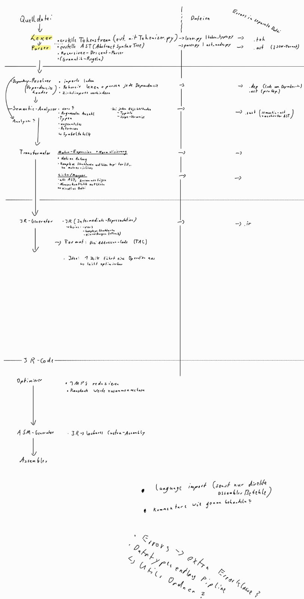

# Compiler-Plan

Stand: Entwurf. Vorhanden sind Token-Definitionen und Lexer (`compiler/lexer/`) sowie der Assembler am Ende der Pipeline (`assembler/`). Begriffe: [Glossar](glossar.md).

## Pipeline

| Stufe | Aufgabe | Stand |
|---|---|---|
| Lexer | Quelltext → Tokenstrom | vorhanden |
| Parser | Tokens → AST (Recursive Descent) | offen |
| Dependency-Resolver | Imports laden, rekursiv lexen und parsen, Zirkelimporte verhindern | offen |
| Semantic-Analyser | Typen, Argumentanzahl, ungenutzter Code, Referenzen, Symboltabelle → annotierter AST | offen |
| Transformator | Makros expandieren, Strukturen vereinfachen (z. B. `for`), alle ASTs zu einem zusammenführen, Namenskonflikte auflösen | offen |
| IR-Generator | flacher Drei-Adressen-Code, eine Zeile = eine Operation | offen |
| Optimierer | Sprünge reduzieren, Konstanten zusammenrechnen | offen |
| ASM-Generator | IR → Assembler für diese CPU | offen |
| Assembler | ASM → Binärdatei | vorhanden |

Skizze: Zwischendateien `.tok`, `.ast` (JSON), `.dep`, `.sast`, `.ir`; Fehler in eigenen Dateien.

## Noch zu klären

- `import` von Sprachdateien (sonst nur direkte Assembler-Befehle)
- Umgang mit Kommentaren
- eigene Fehlerklasse (Lexer-Fehler sind bisher in `lexer.py` definiert; `errors/` gibt es noch nicht)
- Datentypen entlang der Pipeline, gemeinsamer `utils`-Ordner

## Vorgehen (Idee)

- zuerst eine kleine durchgehende Version vom Lexer bis zum Assembler (Variablen, Rechnen, `if` / `while`, Funktionen), danach Imports und Optimierer
- Zwischenformate eher als optionale Debug-Ausgabe (z. B. AST-Dump) statt als feste Schnittstellen
- Transformator zunächst in Parser und IR-Generator aufgehen lassen
- eine zentrale Fehlerklasse mit Datei, Zeile und Spalte

## Ideen zur Zielarchitektur

Noch nicht festgelegt.

- **Datentyp:** 8-Bit-Ganzzahl, standardmäßig signed (Zweierkomplement, −128…127)
- **Stack:** `SPL` ändert sich, `SPH` bleibt fest, also höchstens 256 Byte (ein Rücksprungziel braucht 2 Byte). Der RAM wird über `HI:LO` adressiert, deshalb muss der Stackpointer vor jedem Zugriff nach `LO` / `HI` kopiert werden. Alternative: nur `SPL`, `SPH` aus einer festen RAM-Adresse lesen (ein Takt mehr).
- **Aufruf / Rücksprung** ohne eigene Befehle: Rücksprungadresse auf den Stack, `HI:LO` auf das Ziel, Sprung; zurück per Pop nach `LO` / `HI`. Labels sind Konstanten zur Übersetzungszeit.
- **16-Bit-Werte:** Konstanten aus zwei `IMV`; Rechnen über das Carry-Flag, später ggf. `ADC` / `SBC`
- **Speicher:** 8K RAM; Aufteilung in globale Daten, Stack und eventuell Heap offen
